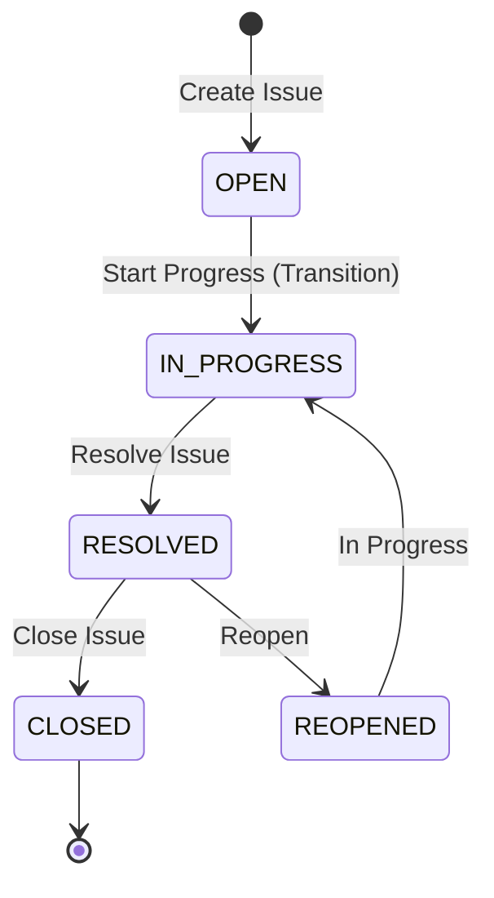

# Practical 5: Workflow Customization

> **Source:** AI Module 2 Lab Manual (Pages 15–17)  
> **Course:** BSc IT — Artificial Intelligence / Agile Project Management  
> **Platform:** Atlassian Jira Cloud  

---

## 1. Objective
To understand Jira's underlying workflow engine by designing a custom workflow, adding a new **Status**, configuring a **Transition** with automated **Rules/Conditions**, and **Publishing** the workflow draft to associate it with the project's issue types.

---

## 2. Requirements
1. Jira Cloud administrative or project configuration privileges on the **"AI learning"** (Key: **AL**) project.
2. A Company-managed Jira project (as created in Practical 1).
3. Access to Jira's graphical Workflow Editor via a modern desktop browser.
4. Fundamental understanding of states, transitions, and business rules in software development.

---

## 3. Core Workflow Concepts Explained

- **Workflow:** The sequence of steps (statuses) an issue follows from creation to completion.
- **Status:** The state of an issue at a specific point in time (e.g., *Open*, *In Progress*, *Resolved*, *Closed*).
- **Transition:** A directional link connecting two statuses representing an action taken by a team member (e.g., *Start Progress* moves an issue from *Open* to *In Progress*).
- **Condition / Rule:** A rule that controls whether a transition can occur (e.g., *Only assignees can move this issue*, or *Field 'Fix Version' must not be empty*).
- **Publishing:** Committing a workflow draft into the live production environment so active issues can use it.

---

## 4. Procedure

### Part A: Access Workflows and Add a Workflow Scheme
*(Refer to PDF Pages 15–16)*

#### Step 1: Open Project Workflows in Space Settings
- **Navigation:** Left sidebar menu -> Click **Space settings** (or **Project settings**) -> Click **Workflows**.
- **Action:** Wait for the project's Workflow Schemes page to load.
- **Expected result:** The active workflow scheme is displayed (e.g., `AL: Software Simplified Workflow Scheme`) showing assigned issue types (Epic, Bug, Story, Task, Sub-task).

#### Step 2: Initiate Adding a Workflow
- **Navigation:** Top-right corner of the Workflows table.
- **Action:** Click the **Add Workflow** button dropdown -> Select **Add Existing** (or click **Create New Workflow**).
- **Expected result:** A catalog of existing workflows appears.

#### Step 3: Select the Classic Default Workflow
- **Navigation:** Existing workflows selection dialog.
- **Action:**
  1. Select **classic default workflow** (or choose the system default workflow scheme).
  2. Click **Next**.
  3. Under **Assign Issue Types**, check the boxes for: `Bug`, `Story`, `Task`, `Sub-task`.
  4. Click **Finish**.
- **Expected result:** The workflow is loaded into the project draft editor with an alert: *"There are unpublished changes. Do you want to publish this draft now?"*

#### Step 4: Open the Visual Workflow Diagram
- **Navigation:** Next to the workflow title (`classic default workflow`).
- **Action:** Click on the **Diagram** toggle button (switch from *Text* to *Diagram* mode).
- **Expected result:** The interactive graphical workflow canvas opens, rendering visual status nodes (`OPEN`, `IN PROGRESS`, `RESOLVED`, `REOPENED`, `CLOSED`) connected by transition arrows.

---

### Part B: Add a Transition and Configure Conditions / Rules
*(Refer to PDF Pages 16–17)*

#### Step 5: Click Add Transition
- **Navigation:** Top toolbar of the workflow diagram canvas.
- **Action:** Click on the **+ Add transition** button.
- **Expected result:** The *"Create transition"* modal dialog window opens.

#### Step 6: Configure Transition Endpoints
- **Navigation:** *"Create transition"* modal dialog.
- **Action:**
  1. **From statuses\*:** Select `Open` (or check *Allow all statuses to transition here* if desired).
  2. **To status\*:** Select `In Progress` from the dropdown.
  3. **Name\*:** Enter transition name: `Start Work` (or `In Progress`).
  4. Click the blue **Create** (or **Add**) button.
- **Expected result:** A directional connecting arrow is drawn on the canvas from the `OPEN` status block to the `IN PROGRESS` status block labeled with your transition name.

#### Step 7: Add a Rule / Condition to the Transition
- **Navigation:** Click on the newly created transition line on the canvas.
- **Action:** A properties panel opens on the right side. Under the **Rules** (or **Conditions**) section, click **+ Add rule** (or **Add condition**).
- **Expected result:** The *"Add rule"* window displays available rule templates (e.g., *Restrict who can move an issue*, *Validate field value*, *Set issue field*).

#### Step 8: Select and Save the Rule
- **Navigation:** *"Add rule"* selection window.
- **Action:**
  1. Select the rule: **Restrict transition** (*"Restrict who can move an issue through this transition"*).
  2. Choose permission criteria (e.g., *Only the Assignee* or *Project Administrators*).
  3. Click the blue **Add** button.
  4. Click **Update workflow** on the canvas toolbar.
- **Expected result:** The rule badge appears under the transition details, enforcing the restriction.

---

### Part C: Publish Workflow Draft and Associate with Project
*(Refer to PDF Page 17)*

#### Step 9: Publish the Workflow Draft
- **Navigation:** Top banner in workflow editor displaying *"There are unpublished changes"*.
- **Action:** Click the blue **Publish draft** (or **Publish**) link.
- **Expected result:** The *"Publish Workflows"* migration assistant dialog appears.

#### Step 10: Associate Issue Statuses (Migration Step)
- **Navigation:** Publish Workflows dialog.
- **Action:**
  1. When prompted to backup existing drafts, select **No** (or keep default).
  2. Review the status mapping for existing project issues to ensure existing issues transition smoothly to the new workflow.
  3. Click **Associate** (or **Publish**).
- **Expected result:** Jira processes the schema changes with a loading progress bar: *"Workflow updating..."*.

#### Step 11: Acknowledge and Confirm
- **Navigation:** Migration confirmation screen.
- **Action:** Click the **Acknowledge** (or **Done**) button.
- **Expected result:** The workflow status updates from `DRAFT` to active production. All project issues now follow the newly customized workflow rules.

---

## 5. Verification
To verify that Practical 5 was completed properly:
1. Open **Space settings -> Workflows**.
2. Confirm that the scheme displays your updated workflow without any `DRAFT` banner.
3. Open **AL board**, select an issue in the `BACKLOG` column (e.g., `AL-1`), and click its status dropdown.
4. Confirm that the new transition (`In Progress` / `Start Work`) is available and enforces the configured condition.

---

## 6. Troubleshooting
| Issue | Cause | Solution |
| :--- | :--- | :--- |
| *"Publish draft"* button is disabled | Incomplete or orphaned transition on canvas | Ensure every transition connects a valid source and destination status before publishing. |
| Cannot add custom transitions in a Team-managed project | Simplified board settings only allow column renaming | Custom diagram workflows with conditions require a **Company-managed** project as created in Practical 1. |
| Non-admin teammates cannot transition issue | Transition condition restriction is too strict | Check the rule configured in Step 8 and ensure the teammate is assigned to the issue or holds the required role. |
| Alert *"Workflow schemes limited to 150"* | Standard Atlassian soft-limit warning shown on cloud | This is an informational system warning; click continue. |

---

## 7. Result
A customized workflow based on the **classic default workflow** was successfully designed, configured with an active transition from `OPEN` to `IN PROGRESS`, equipped with a transition condition rule, and published to the **"AI learning"** project.

---

## 8. Viva Preparation

**Q1: What is a Jira Workflow?**  
*Answer:* A Jira workflow is a set of statuses and transitions that an issue moves through during its lifecycle from creation to resolution, reflecting an organization's business process.

**Q2: What is the difference between a Status and a Transition?**  
*Answer:* A **Status** represents the current state of an issue (e.g., *Open*, *In Progress*, *Resolved*). A **Transition** is the one-way link or action that moves an issue from one status to another.

**Q3: What is a Workflow Condition / Rule?**  
*Answer:* A condition or rule evaluates specific criteria (such as user role, permission, or field validation) before allowing a user to execute a transition. If the condition is false, the transition button will not appear.

**Q4: Why must a workflow draft be "Published" in Jira?**  
*Answer:* Editing an active workflow creates a temporary "Draft" so current production work is not disrupted. Changes only take effect across project boards once the draft is formally published and associated.

**Q5: What is a Workflow Scheme in Jira?**  
*Answer:* A Workflow Scheme connects specific workflows to specific issue types within a project (e.g., Bugs may follow a 6-step QA workflow, while Tasks follow a simple 3-step workflow).

---

## 9. Practical Checklist
- [ ] Navigated to Space settings -> Workflows.
- [ ] Added an existing workflow (Classic Default Workflow).
- [ ] Switched editor to **Diagram** view.
- [ ] Added a transition connecting `Open` to `In Progress`.
- [ ] Configured a transition rule / condition.
- [ ] Clicked **Publish draft** and completed the association wizard.
- [ ] Clicked **Acknowledge** and confirmed active production status.
